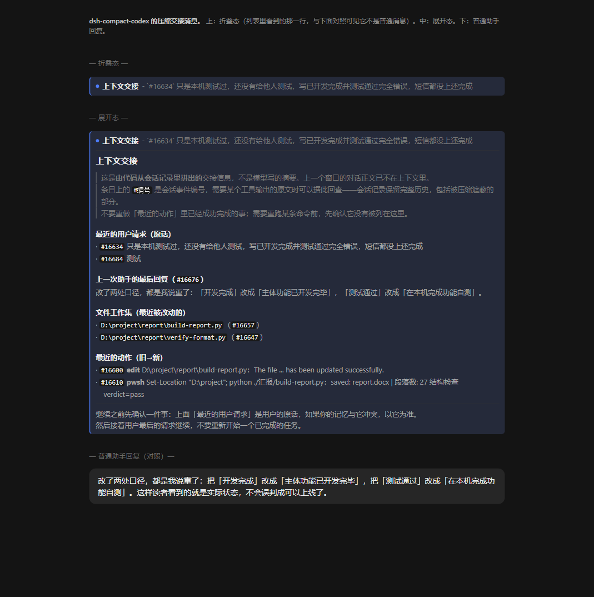

# dsh-compact-codex

Codex 风格的压缩后端。以可拆卸插件形式接管 dsh 的 `ctx.compaction` 服务，替换 `@deepseek-ai/dsh-compaction-basic`，对**所有 agent preset** 生效——不是绑在某一个预设上。

它**只做换窗，不做摘要**：上下文接近窗口上限时，不发起模型调用，直接以一条代码拼出的交接信息替换整段历史。由此绕开「为了压缩而发的请求本身也超限」的死循环，也让换窗不再花时间和额度。

围绕换窗，插件另外补了三件事：换窗后不丢「打算做什么」的任务账本、能按编号回查被遮蔽历史的历史检索、以及判断换窗时机的缓存观测。

## 特性

- **零摘要换窗**：完全不调模型，检查点是代码拼出的交接信息，按时间倒序排：最新请求（原话）、上一轮助手回复、账本主页、最近的动作、文件工作集、更早的请求轨迹、任务起点（首个请求原话）。换窗与账本读写这类自指动作不进动作段——新窗口会把「上一步刚换过窗」读成待办，接着再换一次。
- **编号可回查**：交接信息里的 `#编号` 是会话事件的 `seq`，用 `history` 工具按编号读原文，包括被压缩遮蔽的部分——不需要另存历史副本。
- **任务账本**：跨窗口保留意图与下一步。标 `done` 必须给出真实成功的工具结果编号，锚点必须能在文件里唯一定位，两条规则由代码把关。一个任务的记录按字数预算从新往旧取，不按条数砍——最旧的那条常常最关键（数据源定稿、硬约束、踩过的坑），而前一次换窗已经把正文遮掉了，丢了就再也找不回来。
- **换窗前自动快照**：压力换窗与冷缓存换窗发生时模型往往来不及记账，插件会先由代码把未记账的工具结果归档成一条快照（`through` 盖到当前历史编号），账本时间线由此与交接信息对齐——新窗口不会拿过时的「进行中」记录重推已完成的步骤。摘要只写工具名加参数，记账与换窗这类自指动作不归档。
- **压前最后一道闸**：压力压缩真正执行前，若账本还不新，先推迟一步把记账提醒送进当前回合，下一次步边界照压。提醒一个窗口只发一次——基类的阈值比本插件高时，它会连着好几步都不压，只看「在推迟中就发」会让同一句提醒在每个步边界、每次 `pre-step` 调用各刷一遍。
- **两个提示时点**：平时不注入任何 token 数字——模型看到数字就会去算，那是纯分心。压前闸推迟的那一步注入一条只要求记账的提示；越过压缩点那一刻改注入换窗指令：先 `ledger_append`，再 `new_context`，不要先结束回合。带具体用量的读数是可选诊断（`budgetContext`），默认关闭。
- **缓存观测与保活**：从 provider 报的读写缓存量判断前缀规模与冷热，并在读数里显示；空闲时按次数预算保活缓存，让下一次请求仍命中已有前缀。保活会发真实请求消耗额度，有前缀下限、空闲预算与连续失败即停三层收口。
- **冷缓存换窗**：缓存已过期且上下文够大时主动换窗，此时整段重写前缀已不可避免。不调模型，默认开启。
- **浏览器半侧渲染**：交接信息渲染成一张可折叠的卡片，而不是官方压缩行样式里的一行灰字。无构建步骤，手写即产物。

## 界面

换窗时落地的交接信息不再走官方那套「一行灰色小字 + 可展开正文」，而是渲染成一张卡片，与普通消息一眼可分。自上而下是折叠态、展开态，以及与普通助手回复的对照：



## 环境要求

- dsh ≥ 0.2.2-rc.1（`dsh.compatibility` 与 `peerDependencies` 都按这个下限声明，低于它会被 dsh 判为不兼容并禁用）
- Node.js ≥ 22.5.0（随 dsh 的要求）
- pnpm（`dsh plugin` 安装依赖时用，桌面版自带）
- git（从 git 地址安装时用；仓库已在本地则不必）

## 安装

本包是标准 dsh 插件：`package.json` 的 `dsh.bundle.patch` 让 dsh 认出它是 Bundle 层，`peerDependencies` 声明由 dsh 运行时提供的包，`files` 白名单决定分发的文件。安装走 dsh 自己的插件命令，不需要手改 profile。

```powershell
dsh plugin --profile desktop add git+https://github.com/niszhum/dsh-compact-codex.git
```

需要本机有 `git` 并在 PATH 里。离线环境可以先 `npm pack`，再把产出的 `.tgz` 路径交给 `add`。

`dsh plugin --profile <name> add` 做四件事：取包、按 `peerDependencies` 装好宿主提供的包、把包写进 profile 的 `dependencies`、把 `dsh-compact-codex` 追加进 `dsh.profile.bundles`（追加到末尾，天然排在官方 bundle 之后）。装完重启 dsh。

### 开发态：link 安装

改完代码就想立刻生效、不重新打包时用 link：

```powershell
dsh plugin --profile desktop add dsh-compact-codex@link:<repo>
```

link 指向仓库本体，模块解析走仓库自己的 `node_modules`；pnpm 不会为链接包补 peer 依赖，所以还要把 dsh 运行时提供的 `@deepseek-ai/*` 联接进仓库，命令见 [实现说明](docs/internals.md#依赖解析)。打包与 git 安装不需要这一步：`peerDependencies` 已声明这些包，pnpm 安装时会解析。

### 手动安装

`dsh plugin add` 已经代劳，要手写就两步。

**其一，写进 profile。** `$DSH_HOME/profiles/<name>/package.json` 的 `dependencies` 加来源（tgz 用 `file:`，仓库用 `link:`），并在 `dsh.profile.bundles` 末尾追加 `"dsh-compact-codex"`。它必须排在 `@deepseek-ai/dsh-web-app` **之后**，否则自带的 patch 会被官方 preset 声明覆盖回去——追加到末尾即可。

**其二，`pnpm install` 后重启 dsh。**

`cordis.patch.yml` 是从官方 preset 生成的，已随包提供；dsh 升级后要重跑 `node ./sync-presets.mjs` 再重启——新版本可能改 preset 声明，patch 要跟着重生成。

`link:` 方式额外需要把 dsh 运行时的包联接进仓库（见上一节）；`file:` 与 git 方式由 `peerDependencies` 解析，不需要。

## 快速开始

装好之后不需要额外配置。缓存保活默认开启——它会在会话空闲时发真实请求以维持缓存命中，不需要就设 `keepalive: false`。

重启 dsh 后，对话里默认不会出现任何预算数字：整套压缩对模型是隐形的，直到越过压缩点那一刻。

越过压缩点时模型会收到一条不含数字的提示：

```markdown
Context compaction is available now: this window has reached its compaction point.
Do two things in the current turn, in this order.
First call ledger_append: the task id, what is done, and the single next step.
Then call new_context to reset the window — its ledger gate opens once this window has an entry for the current request.
Do not end the turn first: an idle window at the compaction point has no step left to act on it.
```

在那之前还有一次**压前记账提醒**：压力压缩真正执行前，若账本不新会先推迟一步，把记账提示送进当前回合。它在时序上是必要的——压缩点那一刻基类已经压完了，提示赶不上；而推迟那一步是压缩前唯一一个「提醒还来得及」的位置。

收到换窗指令后模型先记账、再换窗，整段历史被换成一条交接信息，在界面上渲染成一张卡片。要看具体用量时把 `budgetContext` 打开，读数才会按 `budgetRefreshMs` 的间隔注入（含缓存冷热那一行）。

## 工具

插件向模型注册四个工具：

| 工具 | 说明 |
| --- | --- |
| `new_context` | 模型主动请求换窗。调用只登记请求，在下一个步边界消费并执行换窗；环境状态不受影响。窗口刚重置过、还空着时直接拒绝并说明，避免补做上一个窗口没做完的动作 |
| `ledger_append` | 向任务账本追加一条记录。这是模型自己的义务、不是等提醒——完成一个阶段就记一条。`task_id` 标识任务，`status` 取 `in_progress` / `done` / `superseded` / `blocked`，未完成时写 `next_step`（接着做什么）、`done_when`（做到哪算完）与 `anchors` |
| `ledger_read` | 读任务账本。`view` 取 `home`（概览）/ `current`（当前窗口）/ `search`（按词搜索） |
| `history` | 检索或读取历史。`action` 为 `search`（按词、角色、工具名、路径、窗口过滤）或 `read`（按编号读原文，`field: "input"` 读那次调用的完整参数） |

`new_context` 有两道账本门槛：本窗口在最新用户请求之后记过账，且最近一次记账之后未记账的工具结果不超过 25 个。两道只在「本窗口有新的真人请求」时检查，其余情况由换窗前的自动快照兜底——那种窗口里的工作都源自更早的请求，逼模型记账只能复述上一窗口的事。账本还空着时不拦。

## 配置

在 profile patch 或 preset 里给这一行加 config：

```yaml
- id: compaction-basic
  name: 'dsh-compact-codex'
  config:
    handoffTokens: 20000      # 交接信息的规模上限（估算 token）
    thresholdRatio: 0.5
    retainTokens: 32768
    budgetContext: false      # 诊断读数，默认关闭（发数字会让模型去算）
    budgetRefreshMs: 600000   # 读数节流间隔，0 为每步都发
```

本插件自有字段：

| 字段 | 默认 | 含义 |
| --- | --- | --- |
| `style` | `"reset"` | 只接受 `"reset"`（换窗、不调模型）。配其他值会在载入期报错，提示卸载本插件 |
| `handoffTokens` | `15000` | `reset` 模式交接信息的规模上限（估算 token） |
| `budgetContext` | `false` | 是否注入带具体用量的诊断读数（含缓存冷热与 provider 实报／本地估算的偏差比）。默认关闭；压缩点提示不受这个开关影响 |
| `budgetRefreshMs` | `600000` | 诊断读数之间的最小间隔（仅 `budgetContext` 打开时生效）；`0` 为每步都注入 |
| `keepalive` | `true` | 是否在空闲时保活缓存。**会发真实请求消耗额度**，不需要时关掉 |
| `cacheTtlMs` | `3600000` | 缓存 TTL 的假设值。provider 侧的真实值不下发，所以可配 |
| `keepaliveAfterMs` | `3120000` | 空闲多久开始保活 |
| `minCacheReadTokens` | `40000` | 前缀规模低于此值时，重写它的代价与保活一次相当 |
| `idleKeepaliveBudget` | `3` | 两次真实请求之间最多保活几次 |
| `maxConsecutiveFailures` | `2` | 连续失败这么多次就停，不再重试 |
| `coldSwitch` | `true` | 冷缓存时主动换窗（不调模型，所以默认开） |
| `coldMinTokens` | `100000` | 冷缓存换窗的上下文下限，低于此值时换窗省下的重写不足以抵消换窗本身 |
| `checkEveryMs` | `15000` | 缓存保活检查的周期（另有 idle 事件补一次机会） |

其余字段与 `dsh-compaction-basic` 完全一致，语义不变。载入期校验同样适用：`retainTokens` 必须小于 `thresholdTokens`，`retainRatio` 必须小于 `thresholdRatio`。

**不要直接改 `cordis.patch.yml`**，它每次都会被 `sync-presets.mjs` 覆盖。把要注入的配置写成同目录的 `preset-config.json`，再跑 `node ./sync-presets.mjs`，配置会挂到三个 preset 的压缩行上：

```json
{
  "handoffTokens": 20000
}
```

不必写 `style`——本插件只接受 `"reset"`，写成别的值会在载入期直接报错。

## 脚本

| 脚本 | 用途 |
| --- | --- |
| `sync-presets.mjs` | 从官方 bundle 的 preset 生成 `cordis.patch.yml`，只替换压缩后端的模块名 |

dsh 升级后重跑一次即可重新对齐：

```powershell
cd <repo>
node ./sync-presets.mjs
```

四个工具的注册是一次性的：启动时经 `ctx.inject(['tools'], …)` 注册，失败只在 stderr 打一行 `<工具名> tool not registered`。判断注册结果，看启动输出里有没有那一行——没有即为注册成功。

## 项目结构

```text
├─ lib/
│  ├─ index.js              压缩引擎、预算读数、四个工具的注册
│  ├─ client.js             浏览器半侧：交接卡片的渲染器
│  ├─ ledger.js             任务账本的校验与渲染
│  ├─ cache.js              缓存冷热判定与保活决策
│  └─ preset.js             preset 入口
├─ test/
│  └─ handoff.test.mjs      离线断言：交接信息结构、账本字段、PTC 路径解析
├─ docs/
│  ├─ how-it-works.md       换窗机制、交接信息、预算读数、账本、历史、缓存
│  └─ internals.md          preset 覆盖语义、依赖解析、实现对齐与已知边界
├─ cordis.patch.yml         生成物，由 sync-presets.mjs 覆盖
├─ preset-config.json       配置覆盖
├─ sync-presets.mjs         生成 cordis.patch.yml
├─ preview-handoff.html     交接卡片的预览页（上图即由它截出，非运行期产物）
├─ preview-handoff.png
├─ LICENSE                  MIT
└─ package.json
```

## 测试

离线断言，不启动 dsh、不调模型：

```powershell
node --test test/handoff.test.mjs
```

需要仓库 `node_modules` 里的运行时包（`install.ps1` 建的目录联接），否则 `lib/index.js` 的 import 解析不到。

## 文档

- [工作原理](docs/how-it-works.md)——换窗怎么落地、交接信息由哪几段组成、账本与历史为什么这么设计、缓存冷热怎么判断
- [实现说明](docs/internals.md)——为什么必须整份覆盖 preset 声明、依赖怎么接、`new_context` 与 codex-rs 的对齐、改动代码时的底层约束

## 卸载

```powershell
dsh plugin --profile desktop remove dsh-compact-codex
```

`dsh plugin remove` 把它从 profile 的 `dependencies` 与 `dsh.profile.bundles` 里一起摘掉；`pnpm install` 后重启，官方 `compaction-basic` 完整恢复，无需改动任何官方文件。

手写安装的那份要自己摘：从 `dsh.profile.bundles` 与 `dependencies` 里删掉对应两项再 `pnpm install`。安装脚本动过的文件留了备份：`package.json.bak-compact-codex-<时间戳>`、`pnpm-lock.yaml.bak-compact-codex-<时间戳>`。

## 许可证

[MIT](LICENSE)
