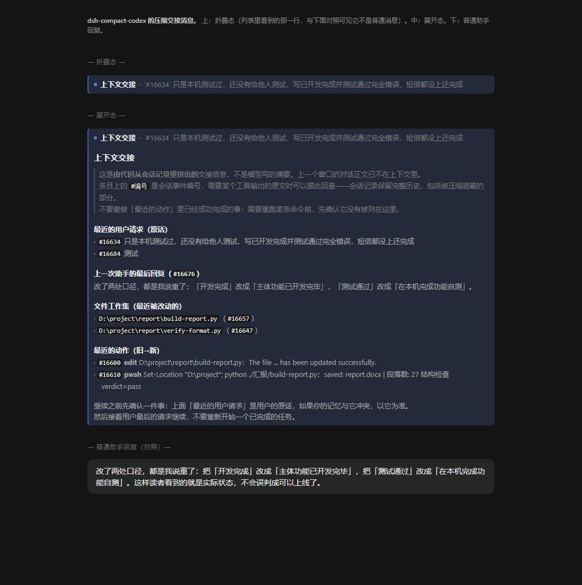

# dsh-compact-codex

Codex 风格的压缩后端。以可拆卸插件形式接管 dsh 的 `ctx.compaction` 服务，替换 `@deepseek-ai/dsh-compaction-basic`，对**所有 agent preset** 生效——不是绑在某一个预设上。

它**只做换窗，不做摘要**：上下文接近窗口上限时，不发起模型调用，直接以一条代码拼出的交接信息替换整段历史。由此绕开「为了压缩而发的请求本身也超限」的死循环，也让换窗不再花时间和额度。

围绕换窗，插件另外补了三件事：换窗后不丢「打算做什么」的任务账本、能按编号回查被遮蔽历史的历史检索、以及判断换窗时机的缓存观测。

## 特性

- **零摘要换窗**：完全不调模型，检查点是代码拼出的交接信息，含最近的用户请求原话、上一次助手回复、文件工作集与最近动作。
- **编号可回查**：交接信息里的 `#编号` 是会话事件的 `seq`，用 `history` 工具按编号读原文，包括被压缩遮蔽的部分——不需要另存历史副本。
- **任务账本**：跨窗口保留意图与下一步。标 `done` 必须给出真实成功的工具结果编号，锚点必须能在文件里唯一定位，两条规则由代码把关。
- **换窗前自动快照**：压力换窗与冷缓存换窗发生时模型往往来不及记账，插件会先由代码把未记账的工具结果归档成一条快照（`through` 盖到当前历史编号），账本时间线由此与交接信息对齐——新窗口不会拿过时的「进行中」记录重推已完成的步骤。
- **压缩点提示**：平时不注入任何 token 数字——模型看到数字就会去算，那是纯分心。越过压缩点那一刻注入一条不含数字的指令：先 `ledger_append` 记账，再 `new_context` 换窗，不要先结束回合。带具体用量的读数是可选诊断（`budgetContext`），默认关闭。
- **缓存观测与保活**：从 provider 报的读写缓存量判断前缀规模与冷热，并在读数里显示；空闲时按次数预算保活缓存，让下一次请求仍命中已有前缀。保活会发真实请求消耗额度，有前缀下限、空闲预算与连续失败即停三层收口。
- **冷缓存换窗**：缓存已过期且上下文够大时主动换窗，此时整段重写前缀已不可避免。不调模型，默认开启。
- **浏览器半侧渲染**：交接信息渲染成一张可折叠的卡片，而不是官方压缩行样式里的一行灰字。无构建步骤，手写即产物。

## 界面

换窗时落地的交接信息不再走官方那套「一行灰色小字 + 可展开正文」，而是渲染成一张卡片，与普通消息一眼可分。自上而下是折叠态、展开态，以及与普通助手回复的对照：



## 环境要求

- Node.js ≥ 22.5.0（随 dsh 的要求）
- 一份已安装并可运行的 dsh
- pnpm（用于 profile 依赖安装）

## 安装

三步，每一步都可逆。

**其一，把包链入 profile。** 在 `$DSH_HOME/profiles/<name>/package.json` 的 `dependencies` 加入（示例里的 `desktop` 是默认 profile 名）：

```json
"dsh-compact-codex": "link:<repo>"
```

**其二，加入 bundle 链。** 同一文件的 `dsh.profile.bundles` 末尾追加：

```json
"dsh-compact-codex"
```

必须排在 `@deepseek-ai/dsh-web-app` **之后**，否则它自带的 patch 会被官方 preset 声明覆盖回去。

**其三，同步依赖并安装。**

```powershell
cd <repo>
node ./sync-presets.mjs          # 生成 cordis.patch.yml
cd "$env:USERPROFILE\.dsh\profiles\desktop"
pnpm install
```

最后重启 dsh。

插件 import 的是 dsh 运行时提供的包，它们不在插件目录的解析路径上；本包用目录联接把它们接进 `node_modules/@deepseek-ai/`，具体命令见 [实现说明](docs/internals.md#依赖解析)。

## 快速开始

装好之后不需要额外配置。缓存保活默认开启——它会在会话空闲时发真实请求以维持缓存命中，不需要就设 `keepalive: false`。

重启 dsh 后，对话里默认不会出现任何预算数字：整套压缩对模型是隐形的，直到越过压缩点那一刻。

越过压缩点时模型会收到一条不含数字的提示：

```markdown
Context compaction is available now: this window has reached its compaction point.
Do two things in the current turn, in this order.
First call ledger_append: the task id, what is done, and the single next step.
Then call new_context to reset the window — its ledger gate opens once this window has an entry for the current request.
Do not end the turn first: an idle window at the compaction point has no step left to act on it.
```

收到之后模型先记账、再换窗，整段历史被换成一条交接信息，在界面上渲染成一张卡片。要看具体用量时把 `budgetContext` 打开，读数才会按 `budgetRefreshMs` 的间隔注入（含缓存冷热那一行）。

## 工具

插件向模型注册四个工具：

| 工具 | 说明 |
| --- | --- |
| `new_context` | 模型主动请求换窗。调用只登记请求，在下一个步边界消费并执行换窗；环境状态不受影响 |
| `ledger_append` | 向任务账本追加一条记录。`task_id` 标识任务，`status` 取 `in_progress` / `done` / `superseded` / `blocked`，未完成时写 `next_step` 与 `anchors` |
| `ledger_read` | 读任务账本。`view` 取 `home`（概览）/ `current`（当前窗口）/ `search`（按词搜索） |
| `history` | 检索或读取历史。`action` 为 `search`（按词、角色、工具名、路径、窗口过滤）或 `read`（按编号读原文，`field: "input"` 读那次调用的完整参数） |

`new_context` 有两道账本门槛，任一不成立就拒绝换窗并说明原因：本窗口在最新用户请求之后记过账，且最近一次记账之后未记账的工具结果不超过 25 个。账本还空着时不拦。

## 配置

在 profile patch 或 preset 里给这一行加 config：

```yaml
- id: compaction-basic
  name: 'dsh-compact-codex'
  config:
    handoffTokens: 20000      # 交接信息的规模上限（估算 token）
    thresholdRatio: 0.5
    retainTokens: 32768
    budgetContext: false      # 诊断读数，默认关闭（发数字会让模型去算）
    budgetRefreshMs: 600000   # 读数节流间隔，0 为每步都发
```

本插件自有字段：

| 字段 | 默认 | 含义 |
| --- | --- | --- |
| `style` | `"reset"` | 只接受 `"reset"`（换窗、不调模型）。配其他值会在载入期报错，提示卸载本插件 |
| `handoffTokens` | `15000` | `reset` 模式交接信息的规模上限（估算 token） |
| `budgetContext` | `false` | 是否注入带具体用量的诊断读数。默认关闭；压缩点提示不受这个开关影响 |
| `budgetRefreshMs` | `600000` | 诊断读数之间的最小间隔（仅 `budgetContext` 打开时生效）；`0` 为每步都注入 |
| `keepalive` | `true` | 是否在空闲时保活缓存。**会发真实请求消耗额度**，不需要时关掉 |
| `cacheTtlMs` | `3600000` | 缓存 TTL 的假设值。provider 侧的真实值不下发，所以可配 |
| `keepaliveAfterMs` | `3120000` | 空闲多久开始保活 |
| `minCacheReadTokens` | `40000` | 前缀规模低于此值时，重写它的代价与保活一次相当 |
| `idleKeepaliveBudget` | `3` | 两次真实请求之间最多保活几次 |
| `maxConsecutiveFailures` | `2` | 连续失败这么多次就停，不再重试 |
| `coldSwitch` | `true` | 冷缓存时主动换窗（不调模型，所以默认开） |
| `coldMinTokens` | `100000` | 冷缓存换窗的上下文下限，低于此值时换窗省下的重写不足以抵消换窗本身 |
| `checkEveryMs` | `15000` | 缓存保活检查的周期（另有 idle 事件补一次机会） |

其余字段与 `dsh-compaction-basic` 完全一致，语义不变。载入期校验同样适用：`retainTokens` 必须小于 `thresholdTokens`，`retainRatio` 必须小于 `thresholdRatio`。

**不要直接改 `cordis.patch.yml`**，它每次都会被 `sync-presets.mjs` 覆盖。把要注入的配置写成同目录的 `preset-config.json`，再跑 `node ./sync-presets.mjs`，配置会挂到三个 preset 的压缩行上：

```json
{
  "handoffTokens": 20000
}
```

不必写 `style`——本插件只接受 `"reset"`，写成别的值会在载入期直接报错。

## 脚本

| 脚本 | 用途 |
| --- | --- |
| `sync-presets.mjs` | 从官方 bundle 的 preset 生成 `cordis.patch.yml`，只替换压缩后端的模块名 |

dsh 升级后重跑一次即可重新对齐：

```powershell
cd <repo>
node ./sync-presets.mjs
```

四个工具的注册是一次性的：启动时经 `ctx.inject(['tools'], …)` 注册，失败只在 stderr 打一行 `<工具名> tool not registered`。判断注册结果，看启动输出里有没有那一行——没有即为注册成功。

## 项目结构

```text
├─ lib/
│  ├─ index.js              压缩引擎、预算读数、四个工具的注册
│  ├─ client.js             浏览器半侧：交接卡片的渲染器
│  ├─ ledger.js             任务账本的校验与渲染
│  ├─ cache.js              缓存冷热判定与保活决策
│  └─ preset.js             preset 入口
├─ docs/
│  ├─ how-it-works.md       换窗机制、交接信息、预算读数、账本、历史、缓存
│  └─ internals.md          preset 覆盖语义、依赖解析、实现对齐与已知边界
├─ cordis.patch.yml         生成物，由 sync-presets.mjs 覆盖
├─ preset-config.json       配置覆盖
├─ sync-presets.mjs         生成 cordis.patch.yml
├─ preview-handoff.html     交接卡片的预览页（上图即由它截出，非运行期产物）
├─ preview-handoff.png
├─ LICENSE                  MIT
└─ package.json
```

## 文档

- [工作原理](docs/how-it-works.md)——换窗怎么落地、交接信息由哪几段组成、账本与历史为什么这么设计、缓存冷热怎么判断
- [实现说明](docs/internals.md)——为什么必须整份覆盖 preset 声明、依赖怎么接、`new_context` 与 codex-rs 的对齐、改动代码时的底层约束

## 卸载

从 profile 的 `dsh.profile.bundles` 移除 `"dsh-compact-codex"`，`pnpm install`，重启。官方 `compaction-basic` 完整恢复，无需改动任何官方文件。

安装时的备份在同目录：`package.json.bak-compact-codex-<时间戳>`、`pnpm-lock.yaml.bak-compact-codex-<时间戳>`。

## 许可证

[MIT](LICENSE)
